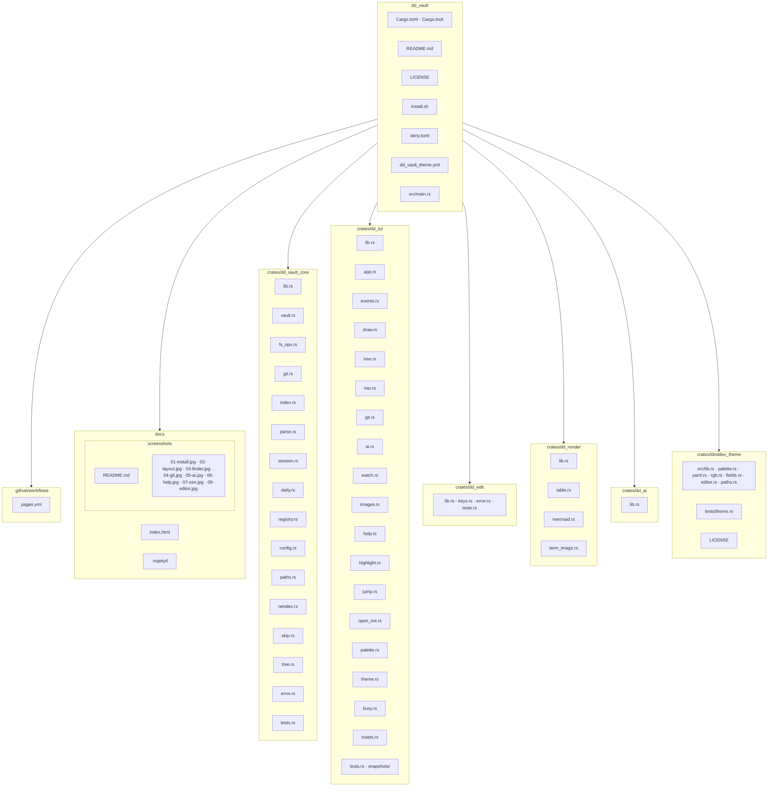
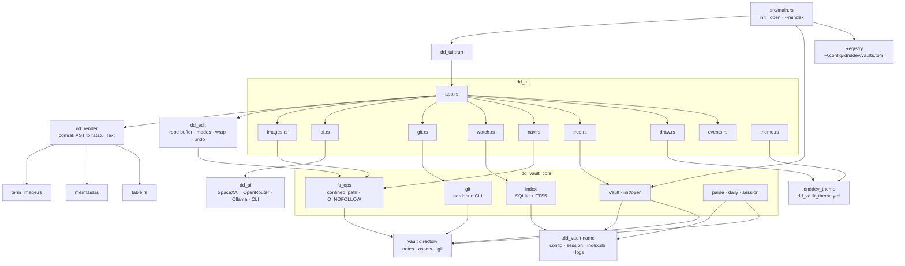

# dd_vault

Keyboard-first, vim-flavored markdown vault TUI. Files on disk are the source of truth. Version 0.1.10. Linux and macOS. Rust 1.82+. MIT.

**Tutorial:** https://ldnddev.github.io/dd_vault/

```bash
curl -fsSL https://raw.githubusercontent.com/ldnddev/dd_vault/main/install.sh | bash
dd_vault init ~/Notes && dd_vault open ~/Notes
```

`install.sh` builds with `cargo build --release --locked` and installs to `~/.local/bin` (`PREFIX` overrides the root). With no arguments, `dd_vault` opens the last vault from `~/.config/ldnddev/vaults.toml`, or a picker. `dd_vault init [path]` creates `notes/`, `notes/daily/`, `notes/projects/`, `assets/`, `.gitignore`, and `.dd_vault-<name>/`. `dd_vault --reindex [path]` rebuilds the search index and exits.

## Using it

The screen is a 3-row header, the body, and a 1-row footer. Tab moves Tree, Notes, Preview. The tree starts collapsed. `j`/`k` move, `h`/`l` fold a folder, Enter opens a file, `a`/`r`/`d` create, rename, and delete.

The notes pane is a vim-style editor (normal, insert, visual, `:` commands) with word wrap, syntect highlighting, and undo. `y` / `yy` copy to the system clipboard. Ctrl+S saves. Ctrl+V pastes a clipboard image into `assets/` and inserts a markdown image. `gf` or Enter follows `[[wikilinks]]` and local markdown links. `gx`, Ctrl+Enter, and Ctrl+click open `http`, `https`, and `mailto` links in the default app.

Preview renders GitHub-flavored markdown in the process: headings, task lists, alerts, wikilinks, tables as a Unicode grid, and `mermaid` flowcharts, sequence diagrams, and pie charts as Unicode boxes. `<Space>p` shows or hides the preview pane. `<Space>P` opens a reading view of that preview. `<Space>z` focuses the note, `<Space>h` is zen, `<Space>e` brings the tree back. Drag the pane borders to resize.

`<Space><Space>` is the command palette. `<Space>ff` finds files, `<Space>sg` searches note text, `<Space>tg` searches tags. `<Space>vv` switches vaults. `<Space>nd` or `:daily` opens `notes/daily/YYYY-MM-DD.md`. Reopening a vault restores the last note, caret, wrap, preview, splits, and zen or focus from `<vault>/.dd_vault-<name>/session.toml`.

`:git status`, `:git pull`, `:git push`, and `:git commit` sync the vault when it has its own `.git`. Commit scans staged text for `ghp_`, `github_pat_`, `AKIA`, `sk-`, `xai-`, and `-----BEGIN` private keys, plus any `secret_patterns` in config. Overlapping pull conflicts keep your side and write `note.conflict-<timestamp>.md` beside it.

AI is off until `:ai on`. The default network provider is SpaceXAI (`grok-4.6`, `XAI_API_KEY`). `:ai provider openrouter` uses a key stored in `~/.config/ldnddev/ai.keys` (mode 0600). `:ai provider ollama` talks to `http://127.0.0.1:11434/v1`. Each request asks before sending the note.

Theme colors load from `dd_vault_theme.yml` in the working directory, then `~/.config/ldnddev/dd_vault_theme.yml`, then the built-in palette. F1 is help. F2 edits the theme. Ctrl+Q quits.

## Safety

Vault reads and writes stay inside the vault root. A path with `..`, an absolute path, or a symlink whose target canonicalizes outside the vault is refused. Note open and save use `O_NOFOLLOW` on the final file. Git invocations override repo hooks, fsmonitor, clean and smudge filters, and credential helpers, clear repo aliases, and refuse `url.*.insteadOf` plus a custom upload-pack or receive-pack. Network AI base URLs must be `https` with no userinfo. Ollama must stay on loopback. Redirects that change scheme, host, or port are refused. Preview image decode is capped at 8192×8192 and 32 MiB.

Hard links inside the vault still look like ordinary files. A directory swapped for a symlink in the gap between the check and the write is not covered.

## Repository



## App



`dd_tui` owns the screen and input. `dd_edit` owns the buffer and does not touch the clipboard or the vault. `dd_render` turns markdown into ratatui text and does not read the disk. `dd_ai` talks to a provider. `dd_vault_core` owns the vault path, git, and the rebuildable index. `ldnddev_theme` loads the shared YAML theme. The root binary is the CLI only.

## Checks

```bash
cargo test --workspace
cargo clippy --workspace --all-targets -- -D warnings
cargo fmt --all --check
```

`deny.toml` is the `cargo deny` policy. GitHub Pages publishes `docs/` from `.github/workflows/pages.yml`.
